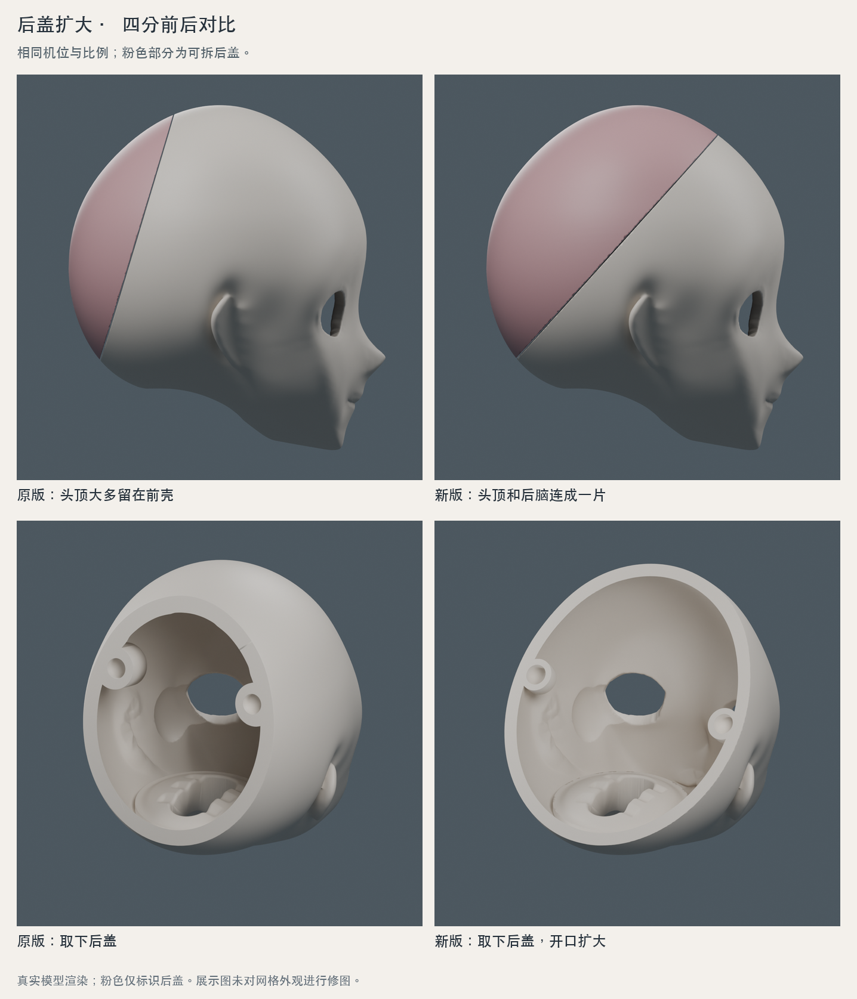

# 三月七四分 v31：头顶与后脑一体的大后盖

[Blender 模型](march7-bjd-head-1-4-v31.blend) · [前头壳 STL](march7-head-shell-1-4-v31.stl) · [后盖 STL](march7-head-cap-1-4-v31.stl)

本版基于 [四分 v30 穿入转向版](../v30-pass-turn-seat/README.md)，重新划分前后壳。**头顶与大部分后脑归入同一块可拆后盖，脸部、耳朵及完整颈座留在前壳**，接近实物参考中前后两片的结构。合盖后的面雕和总体头型沿用来源。

上图以四分为例；[三种尺寸预览](../../../reviews/large-rear-cap-2026-11-16/large-cap-three-sizes.png)展示对应版本。粉色只用于区分后盖，不代表模型换色。

| 参数 | 本版设计 |
| --- | --- |
| 新分片平面 | Y + 0.9Z = 41 mm |
| 沿开盖轴的分片间隙 | 0.25 mm |
| 磁铁 | 4 × 2 mm 圆片，每片头壳 2 个，共 4 个 |
| 磁铁盲孔 | 直径 4.25 mm，深 2.2 mm |
| 贯通颈孔 | 7.6 × 19.2 mm，沿用来源 |

旧切缝附近沿原法向 -0.1 至 0.35 mm 的窄带重新接合，宽度约 0.45 mm；新切缝重新分开。因此“保持外形”指保留面雕及切缝带外的原有外表面，不表示全部网格逐点、逐三角面不变。旧磁铁盲孔填平，旧内侧凸台按周围内壁弧面清理；新磁铁座移到新切缝两侧。未增加顶部定位销。

颈口、浅球面承托台、三道横槽及参考钩绳沿用上一版。参考 S 钩仍为约 30 × 18 × 2.3 mm、绳包络直径 2.2 mm。因为分片和磁铁座改变，本版装配结论应以新文件的检查结果为准，不直接套用旧报告。

**本版最终网格及保存的 Blender 文件核验通过。** 前壳和后盖均水密、各为一个连通件，闭合时无体积重叠；受保护颈区及外部脸耳顶点与来源吻合。切缝带外的外表面射线采样最大差值小于 0.000001 mm；这不是对全部表面点的逐点证明。新盲孔尺寸、侧壁和孔底已采样检查。

使用同一参考钩绳，重新检查了整钩连绳穿入、提起、转向、落座及双肩承托，并检查了新后盖沿开盖轴取出的连续路径。钩绳与名义眼球包围体纳入空间检查，保存文件中的参考物与验证几何一致。见 [本版最终审核](../../../reviews/large-rear-cap-2026-11-16/audit-final-march7-1-4-v31-large-rear-cap.json) 和 [Blender 一致性](../../../reviews/large-rear-cap-2026-11-16/audit-blend-march7-1-4-v31-large-rear-cap.json)。

实际树脂、磁铁胶量、娃体及钩绳的打印试装和承载未验证。

用 Blender「文件 → 打开」打开模型；隐藏 `PRINT_02_Removable_Cap` 可查看前壳内部。`REFERENCE_ONLY__NOT_FOR_PRINT` 中的钩绳仅用于预览，打印使用前壳、后盖两份 STL。

[本轮结构说明、预览和核验](../../../reviews/large-rear-cap-2026-11-16/README.md) · [参数](parameters.json)。来源限制见 `source-usage-rules.txt`。历史版本保留，本轮仅在本地保存，不自动提交或推送。
