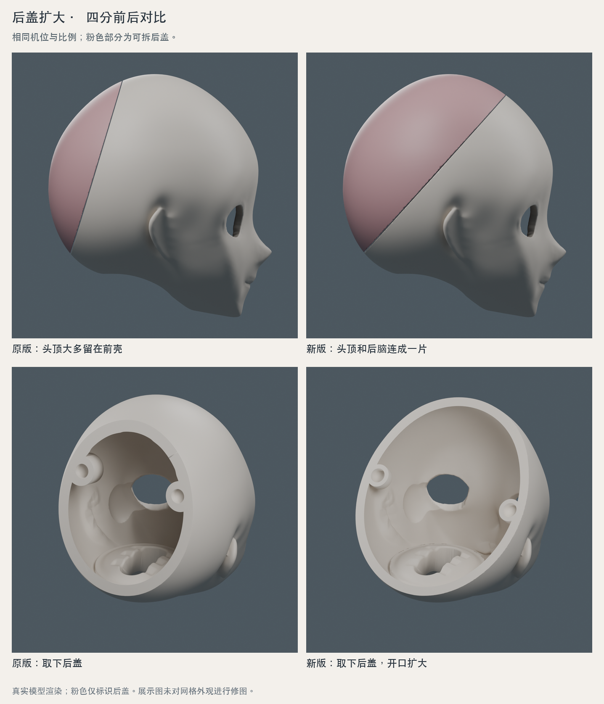
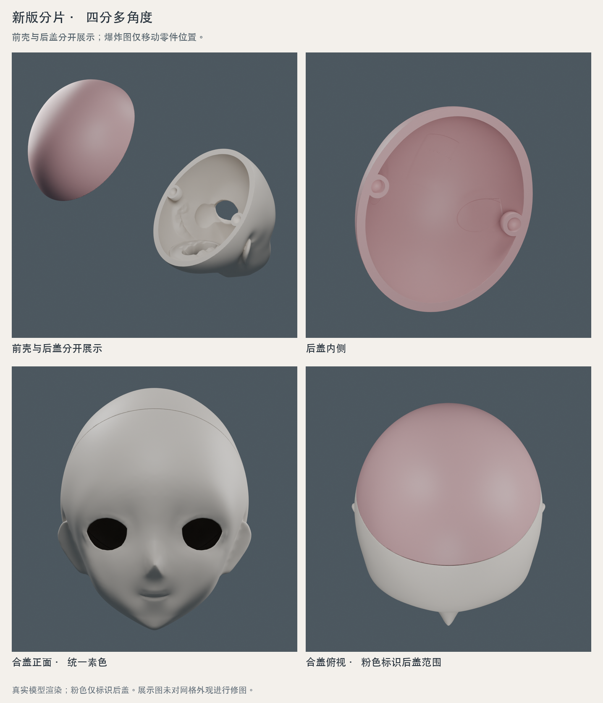
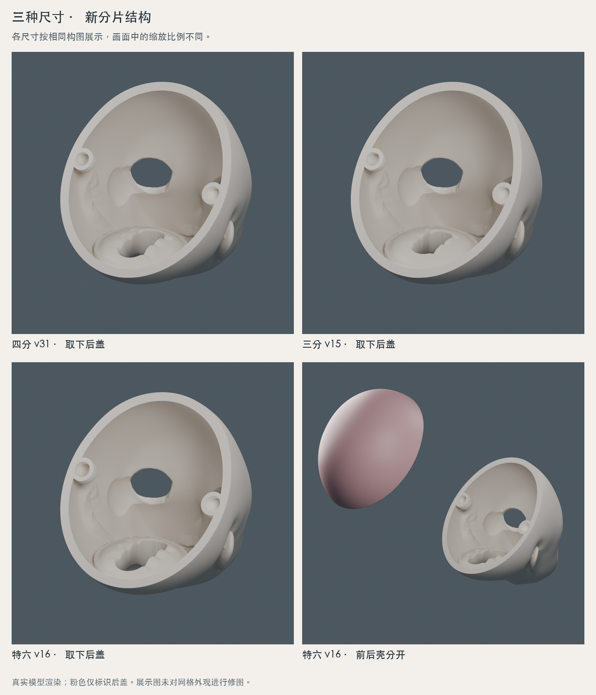

# 三月七大后盖分片：头顶与后脑一体

2026-11-16 按用户提供的实物结构，另存四分 **v31**、三分 **v15**、特六 **v16**。本轮将小后脑盖扩大，头顶和大部分后脑组成同一块可拆后盖；脸部、耳朵及完整颈座属于前壳。整体接近前后两片，不以材料体积严格各占 50% 为目标。

图像直接来自保存模型的渲染，粉色只标识后盖；拼图只做等比缩放和加标题，爆炸图只移动零件展示。分片方向参考用户提供的 [打开头壳实物图](user-reference-open-head.jpg) 和 [前后两片实物图](user-reference-front-back-halves.jpg)，照片未作为毫米尺寸测量依据。

| 尺寸 | 新版本 | 来源 |
| --- | --- | --- |
| 四分 | [v31 模型与 STL](../../1-4/versions/v31-large-rear-cap/README.md) | [v30 穿入转向版](../../1-4/versions/v30-pass-turn-seat/README.md) |
| 三分 | [v15 模型与 STL](../../1-3/versions/v15-large-rear-cap/README.md) | [v14 穿入转向版](../../1-3/versions/v14-pass-turn-seat/README.md) |
| 特六 | [v16 模型与 STL](../../1-6-special/versions/v16-large-rear-cap/README.md) | [v15 穿入转向版](../../1-6-special/versions/v15-pass-turn-seat/README.md) |

## 修改范围

新分片采用 `Y + 0.9Z = 41 × s mm`，`s` 为相对四分的尺寸比例；分片间隙沿开盖轴为 `0.25 × s mm`。旧切缝沿原法向 `[-0.1, 0.35] × s mm` 的窄带重新接合，再按新平面分片。面雕及这两处切缝带外的原有外表面保留；这里不宣称全部三角面拓扑或原切缝处外表面不变。

新后盖覆盖头顶和后脑，前壳保留面部、双耳和颈部承托。三种尺寸在各自切面上的主通道净开口面积均约为原来的 **1.61 倍（增加约 61%）**，不把磁铁盲孔计入通道开口。四分最终网格按法向分类估计，后盖外表面积约为旧盖的两倍。该分类会包含少量孔沿和边缘，只用来描述开盖范围扩大，不代表材料体积严格各占一半。

旧磁铁盲孔填平，旧凸台局部顺着周边内壁弧面清理，左右各一对磁铁移到新切缝。四分、特六仍使用 4 × 2 mm 圆片，三分使用 5 × 2 mm 圆片；每个零件两个盲孔，孔深 2.2 mm，孔径分别 4.25 / 5.25 mm。继续采用磁铁吸合，不增加顶部定位销。

颈口、承托台、三横槽、参考钩绳形状和落座姿态沿用来源。S 钩仍按用户确认的约 30 × 18 × 2.3 mm 近似模型，配 2.2 mm 刚性绳包络；安装方式仍为连绳穿入、提起、转 90°、横向落中槽。新磁铁座与后盖位置改变后，需要检查新文件的空间关系，旧报告仅作来源证据。

## 核验状态

[最终审核汇总与文件哈希](audit-final-summary.json)。

三种尺寸的最终 STL 和保存的 Blender 文件均已核验通过：前壳、后盖分别水密且单一连通，合盖无体积重叠；颈区及受保护的外部脸耳顶点与来源吻合，切缝带外的外形另做射线采样对照。磁铁盲孔直径、深度、侧壁及孔底进行了采样检查。

同一参考钩绳在本版最终网格上重新通过连绳穿入、提起、90° 转向、下降落槽及双肩承托检查；新后盖沿开盖轴取出也通过连续路径核验。空间障碍包括名义眼球包围体及参考钩绳，保存 Blender 内的参考物与验证几何吻合。

| 版本 | 实际分片间隙 | 外表面射线采样数 / 最大误差 | 证据 |
| --- | --- | --- | --- |
| 四分 v31 | 0.25000 mm | 3401 / < 0.000001 mm | [最终网格审核](audit-final-march7-1-4-v31-large-rear-cap.json) · [Blender 一致性](audit-blend-march7-1-4-v31-large-rear-cap.json) |
| 三分 v15 | 0.31249 mm | 3402 / < 0.000001 mm | [最终网格审核](audit-final-march7-1-3-v15-large-rear-cap.json) · [Blender 一致性](audit-blend-march7-1-3-v15-large-rear-cap.json) |
| 特六 v16 | 0.22224 mm | 3385 / < 0.000001 mm | [最终网格审核](audit-final-march7-1-6-special-v16-large-rear-cap.json) · [Blender 一致性](audit-blend-march7-1-6-special-v16-large-rear-cap.json) |

射线避开旧、新切缝带，仅覆盖从共同头部中心可见的表面；不是所有表面点或全局最薄壁证明。磁铁周壁检查也不代表胶粘或树脂承载试验。

[旧磁铁座清理初次预检查](old-magnet-cleanup-preflight.json)仅保留为初次工具方案记录；当前采用与来源内壁平滑衔接的清理方案，其局部结果写入各版本 `geometry-stage.json`。两者均不代替最终网格、装配和外形保护核验。

真实树脂打印、磁铁与胶层、娃体吻合、弹力绳受力和承载均未试验。数字检查通过也不等同于通用娃体或所有 S 钩适配。

## 打开模型

在 Blender 中打开对应 `.blend`，隐藏 `PRINT_02_Removable_Cap` 看前壳内部；钩绳位于非打印参考集合。打印只使用对应的前壳和后盖 STL。

上一轮模型及其报告保留原样。本轮仅在本地保存，不自动提交、推送或发布；原角色素材使用限制随版本保留。
