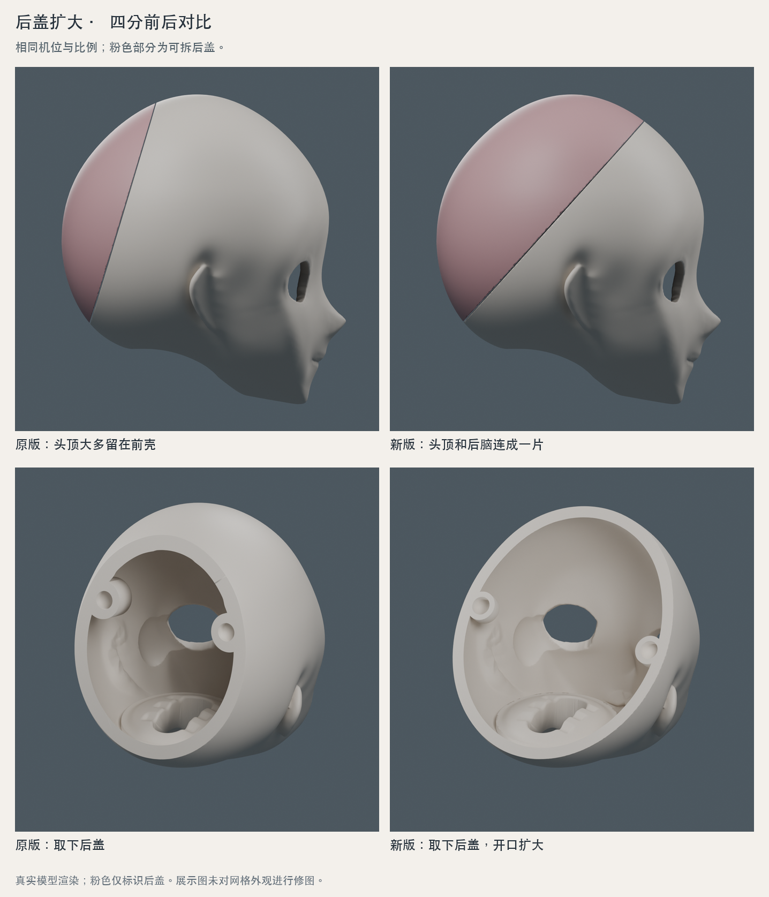

# 最新确认模型：三月七大后盖版

2026-11-16 用户确认本轮分片更符合预期，并要求提交及同步 GitHub。当前交付为四分 **v31**、三分 **v15**、特六 **v16**：头顶和后脑属于同一块可拆后盖，净开口面积比上一版扩大约 61%。面雕、总体头型及颈部承托结构保留，磁铁移至新接缝。

| 尺寸 | Blender | 打印 STL | 参数与说明 |
| --- | --- | --- | --- |
| 四分 v31 | [模型](../characters/march-7th/1-4/versions/v31-large-rear-cap/march7-bjd-head-1-4-v31.blend) | [前壳](../characters/march-7th/1-4/versions/v31-large-rear-cap/march7-head-shell-1-4-v31.stl) · [后盖](../characters/march-7th/1-4/versions/v31-large-rear-cap/march7-head-cap-1-4-v31.stl) | [版本说明](../characters/march-7th/1-4/versions/v31-large-rear-cap/README.md) |
| 三分 v15 | [模型](../characters/march-7th/1-3/versions/v15-large-rear-cap/march7-bjd-head-1-3-v15.blend) | [前壳](../characters/march-7th/1-3/versions/v15-large-rear-cap/march7-head-shell-1-3-v15.stl) · [后盖](../characters/march-7th/1-3/versions/v15-large-rear-cap/march7-head-cap-1-3-v15.stl) | [版本说明](../characters/march-7th/1-3/versions/v15-large-rear-cap/README.md) |
| 特六 v16 | [模型](../characters/march-7th/1-6-special/versions/v16-large-rear-cap/march7-bjd-head-1-6-special-v16.blend) | [前壳](../characters/march-7th/1-6-special/versions/v16-large-rear-cap/march7-head-shell-1-6-special-v16.stl) · [后盖](../characters/march-7th/1-6-special/versions/v16-large-rear-cap/march7-head-cap-1-6-special-v16.stl) | [版本说明](../characters/march-7th/1-6-special/versions/v16-large-rear-cap/README.md) |

[多角度截图](../characters/march-7th/reviews/large-rear-cap-2026-11-16/large-cap-overview.png) · [三种尺寸](../characters/march-7th/reviews/large-rear-cap-2026-11-16/large-cap-three-sizes.png) · [最终独立审核](../characters/march-7th/reviews/large-rear-cap-2026-11-16/audit-final-summary.json)

保存的 Blender 与 STL 一致性、网格闭合、受保护面部/耳部/颈部、磁铁盲孔、参考 S 钩完整穿入转向落座与后盖拆卸检查均通过。模型未重新修改，仍需实际树脂打印、磁铁胶层、娃体和钩绳试装及承载验证。

## 本次提交范围

- 三个最新版本的模型、参数、脚本与交付记录。
- 本轮对比图、建模脚本和最终审核证据。
- 最新版构建与独立审核直接需要的上一版输入：四分 v30、三分 v14、特六 v15 的模型及参考钩绳数据等。这些目录是最小只读输入快照，不包含其全部更早迭代、历史脚本或历史链接目标；最新版 `.blend` 可独立打开。
- 旧版本删除和其余本地历史草稿不属于本次提交。

各建模过程记录保持交付时原字节，包括当时的“仅本地保存”“待视觉确认”等描述；用户最新确认与同步范围以本页为准。重建/几何审核脚本依赖 Blender、Python 3.11、NumPy、SciPy、trimesh 和 manifold3d，脚本中的本地运行时路径需按运行机器配置。报告中的旧绝对路径用于来源追溯。

## GitHub 同步

沿用已有私有仓库 `dolls-lab/bjd-modeling`，它继续作为 `origin` 和默认推送目标。已有项目不因个人账号的默认归属偏好另建仓库或替换远端；该偏好只用于没有既定仓库时选择归属。原素材使用说明随模型保存，本次同步不改变其使用条件。后续修改不会自动提交或推送，除非得到相应授权。
